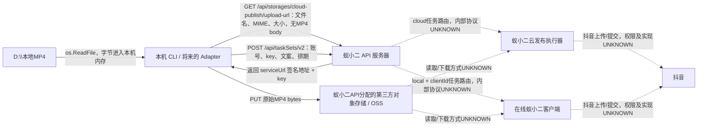

# YIXIAOER_TECHNICAL_POC_PHASE0：素材与授权流向

日期：2026-10-05（Asia/Shanghai），固定commit `a2722c6095f57abf2e345dca637bdded44fa34df`。本轮只下载公开源码/文档，未上传素材、绑定账号、操作客户端或发送发布请求。

## 标准上传路线

实线为固定客户端源码可证明的步骤；虚线仅表达供应商通道意图，内部的数据拉取、转存、代理和抖音最后一跳未公开，不能宣称已追踪网络。

**明确回答：标准 upload 链会把视频二进制上传到蚁小二 API 提供的对象存储节点，第三方存储接收完整MP4。**它不是本机直传抖音。`upload.go` 中的默认bucket为`cloud-publish`，签名由供应商API发放，PUT失败信息明确称OSS。源码能证明供应商分配上传目的地；存储运营商、资产法律归属、实际主机、地域、ACL、保存期限、删除策略及供应商访问权限，未授权联调不能全部证明。因此完整控制关系和后续链路标为 **MATERIAL_DATA_PATH_UNKNOWN**；此标记不掩盖“已确认标准路线发生第三方上传”。

不能声称MP4先经过蚁小二API网关的body：签名GET不带视频bytes，标准PUT直接发送到serviceUrl。视频可能在后端再次转存，证据UNKNOWN。`UploadResult.key`用于发布，`StableURL`只是供应商资源URL，不是抖音作品URL。

依据：[upload.go:59–119](https://github.com/yixiaoer888/yixiaoer-skill/blob/a2722c6095f57abf2e345dca637bdded44fa34df/internal/api/upload.go#L59)、[官方视频流程要求先上传云端](https://github.com/yixiaoer888/yixiaoer-skill/blob/a2722c6095f57abf2e345dca637bdded44fa34df/skills/yixiaoer/references/platforms/video/index.md#L16)。

## local 实际含义

`publishChannel:"local"` 和 `clientId` 选择本机蚁小二客户端执行发布。cloud 会剔除clientId，local没有clientId被拒绝。**local不是存储开关**：上传函数没有publishChannel参数，也没有将绝对MP4路径透传给任务服务的本地视频发布路线。通道更改仍提交到同一个`/taskSets/v2`网关。

官方通道文档要求启动并登录客户端；客户端不在线需恢复在线或另选cloud。本轮不会执行回退。local运行期间客户端必须在线的前提有文档证据；是否必须Windows（而非其他系统）、是否需要可见桌面、定时任务整个等待期是否要保持在线、客户端断线/重启后是否补发：UNKNOWN。cloud在API控制面不指定本机clientId，不能据此保证下层没有远程浏览器或GUI执行器。

依据：[local-vs-cloud](https://github.com/yixiaoer888/yixiaoer-skill/blob/a2722c6095f57abf2e345dca637bdded44fa34df/skills/yixiaoer/references/workflows/local-vs-cloud.md)、[通道解析源码](https://github.com/yixiaoer888/yixiaoer-skill/blob/a2722c6095f57abf2e345dca637bdded44fa34df/internal/workflows/publish/service.go#L827)。

## 抖音账号加入、凭证和恢复 Gate

| 项目 | 核验结论 | 剩余未知 |
|---|---|---|
| 添加抖音账号 | 官方教程：下载登录蚁小二客户端→账号管理→添加账号→选择抖音→扫码绑定；另一官方教程明确使用工具内置浏览器扫码 | 实际二维码URL、授权主体、权限确认页和精确手机确认步骤UNKNOWN；本轮没扫码 |
| OAuth | UNKNOWN | 没有抖音app_id、scope、callback、token endpoint/refresh token流程证据；扫码不能证明OAuth |
| Cookie | UNKNOWN，有浏览器会话迹象 | 账号选择文档提示检查Cookie；不证明抖音必然采用Cookie、托管位置或过期机制 |
| 客户端登录 | 有：蚁小二登录与抖音绑定是两层不同登录 | 不能把蚁小二登录凭证当抖音授权 |
| 手机确认/其他挑战 | UNKNOWN | 是否每次授权要确认、验证码/人脸挑战触发与恢复策略UNKNOWN |
| API Key由谁维护 | 用户在蚁小二客户端/CLI入口获取；CLI本地配置保存apiKey，并放Authorization头；401提示重新设置 | key有效期、轮换、撤销、scope和管理人员权限UNKNOWN |
| 抖音Token由谁维护 | **UNKNOWN** | CLI不实现抖音token或refresh流程；内部由服务端还是客户端维护、Cookie/Token加密位置UNKNOWN |
| 账号授权失效恢复 | status=2/3/4不得继续发布；文档指向重新授权/检查登录 | CLI没有可确认的抖音重新授权API；精确恢复步骤、重绑后ID是否变化、任务是否继续UNKNOWN |
| 长期在线 | local文档要求客户端在线；cloud未绑定本机clientId | cloud实际执行器、local排期等待时长要求、离线恢复UNKNOWN |
| 浏览器/UI自动化依赖 | **BROWSER_LOGIN_DEPENDENCY_CONFIRMED_BY_VENDOR_DOC**；底层发布 **GUI_RPA_DEPENDENCY_UNKNOWN** | 未公开Windows客户端和云执行器；不能断言发布完全无GUI，也不能断言严重RPA已经确证 |

账号教程证据仅支持供应商声称的操作路径，不证明抖音正式开放接口授权。来源：[抖音扫码绑定步骤（2026-01-02）](https://xueyuan.yixiaoer.cn/article/45606)、[内置浏览器绑定说明（官方学院）](https://xueyuan.yixiaoer.cn/article/46394)、[账号选择Cookie/在线提示](https://github.com/yixiaoer888/yixiaoer-skill/blob/a2722c6095f57abf2e345dca637bdded44fa34df/skills/yixiaoer/references/workflows/account-selection.md)、[API Key本地配置](https://github.com/yixiaoer888/yixiaoer-skill/blob/a2722c6095f57abf2e345dca637bdded44fa34df/internal/config/config.go)。官网页面已留存于`publisher_poc/yixiaoer/evidence/`；它们不是固定commit服务端契约。

## 数据路线接受条件

当前AGENTS.md要求素材不上传服务器。本轮没有更改此约束；用户授权的是离线Phase0，不是接受蚁小二对象存储。**Gate G未通过**，不因local字样假定接受。

供应商必须给出标准/local/cloud每跳的素材目的地与控制方、是否可私有化或自有存储、访问/删除/留存协议，以及抖音账号凭证所在节点。若主张本机直传，需提供可复核的实现/流量证据，解释如何避免现有签名PUT路线。只有路线明确且用户明确接受，才可能进入未来真实素材POC；本轮不联系供应商或索要账号。
