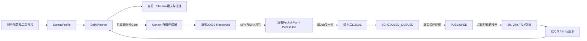
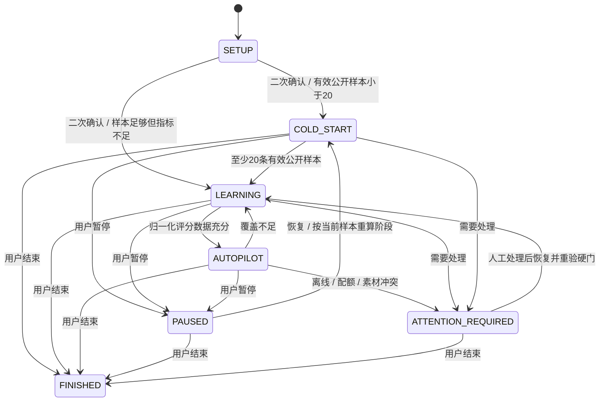

# STARTUP_ACCOUNT_AUTOPILOT 基础架构

## 当前接线（2026-10-06）

当前按用户决定采用三个一级模块：索引模块（图搜/话术搜/描述搜）、视频生成模块（原手动自动起号）、AI托管模块（原长期托管）。SINGLE_STUDIO_MODE=true/AUTH_MODE=DISABLED保持，默认索引→图搜，无员工登录入口；右上角齿轮收纳工程状态、计划/任务及历史POC。旧认证/Admin/手工发布后端仍保留。最终“确认并开始托管”仍必须由用户本人点击，浏览页面不制造长期授权。

手动自动起号通过ui_context使用原StudioPlannerStore/LocalOperator，复用原ContentRegistration与2060S Render/READY链，不和长期Autopilot混合。普通导航在Streamlit fragment中切换；搜索只驻留当前模式的大引擎缓存，RLock保护查询与释放，不改变原模型、索引、排序。连续验证发现1455内存压力导致原托管停派，资源保护完成后按基线恢复已有授权并保留故障/恢复审计；没有重发、改期或创建新任务。当前三模块交付证据runtime/three_module_20261006/REPORT.md。

StudioPlannerStore与LocalOperator替代UI登录主体：所有有效STARTUP账号可选（稳定分组业务分类，不依赖员工启用/绑定权限）；丙曜只读保留，禁止自动纳入托管。004迁移新增studio_operator_identity以及原employees外键兼容的不可登录disabled锚点；身份为LOCAL_OPERATOR/STUDIO_CONSOLE，不伪造Session或登录成旧员工。之后新的配置/模板确认和托管控制保留固定审计ID；历史真实confirmed_by不重写。关闭单工作室开关后恢复原登录路径，已有业务数据不需重建。

本轮开始前用户已开启新账号托管并完成今天5个任务，均SCHEDULED_QUEUED/count1。单工作室修改保留原授权、原5个任务、原模板Version2和所有学习数据；Worker RUNNING/active1。新的局域网浏览器会话已验证无需凭据直接显示自动托管中。12专项/15既有托管/122模板发布/80旧链回归通过，本轮真实Render/Publish新增0，丙曜原28不动。报告runtime/single_studio_20261006/REPORT.md。

`production.py`的ServiceGrant只由operations.db中用户已确认的长期授权产生；每次派发重新验证当前身份模式、有效账号绑定、模板版本、配置与策略hash，外部upload/publish前也验证暂停状态。普通认证模式保持原员工启用/权限校验。单工作室模式下原员工授权依然作为不可变历史证明，但后台不依赖员工身份启用；新确认记STUDIO_CONSOLE。003迁移只新增4张autopilot_表、2个不可变事件触发器和独立AUTOPILOT_DEFAULT发布文字配置，不改既有表结构。两轮SQLite backup保留在对应runtime交付目录。

`production_worker.py`由STARTUP_AUTOPILOT_PRODUCTION_SERVER_01正式pythonw计划任务常驻，每60秒执行；无授权不调用供应商。BEGIN IMMEDIATE及唯一约束保护账号/北京时间槽位与完整素材组合；统一占位包含既有Job、生成/Render/READY/提交/待发布/实际公开。每号每自然日最多5；现有超过5的历史日不补量、不撤销。今天合法槽位优先，否则明天；提前量至少8100秒、最远14天，失去提前量进入ATTENTION_REQUIRED，不静默改期。

Composition有序素材SHA→既有StartupContentRegistration→既有2060S RenderQueue→原MP4校验READY→既有PublishPlan/PublishJob→原YixiaoerPublisherAdapter LOCAL。自动Plan的权限依据是长期确认事件，不伪造每日用户Confirm。upload/validate/dry-run/requestHash/submit intent/count=1/one POST与无窗口runner完全复用现有Adapter。超时不重POST，只读对账；队列成功保持SCHEDULED_QUEUED。

`production_metrics.py`只查询本账号官方content-overviews，匹配原provider作品ID、真实日期且非未来才记录公开样本。2h/24h/72h记录实际观察时间及供应商updatedAt，过期数据等待，未知新鲜度标DATA_FRESHNESS_UNKNOWN。缺失涨粉/完播/观看时长为NULL。生产独立策略startup-production-policy-v1按播放/点赞/评论/分享/收藏可用数据与本账号baseline计算；前20个真实公开样本均衡探索，20后只有LEARNABLE槽位消费本账号slot/material权重，其它账号与模板结构不参与。基础Shadow策略保持不变。

暂停/结束停止新规划、生成与提交；已消费提交闩锁只读对账，平台既有排期保留。结束可选仅停止本账号尚未submit且无intent/claim/task标识的本地任务，不调用平台取消接口。当前完整组合持久唯一约束比模板30天去重更保守；素材耗尽/账号离线/执行中断不自动重造，转需要处理。服务与客户端仍要求当前Windows交互登录Session；不承诺整机注销/重启自动恢复。

早期生产UI报告记录苏政超登录入口与当时未启用状态，是历史证据；当前单工作室入口与用户已启用的实际状态以上文和最新报告为准。现行用户模板Version2为引流→手法→手法→收尾，前三LEARNABLE、收尾ROTATING。收尾池1个不同素材、7天复用上限7次，连续5/天容量不足；不自动改变规则。用户可暂停后调整、预览并保存，再本人重新确认；不能把既有待发布状态记成PUBLISHED。

结构由用户在Slot编辑器选择，段数/顺序/类型/池/策略均由不可变版本约束。FIXED不消费变量片段的疲劳，ROTATING/LEARNABLE/PREFERRED各自设置规则；同类型重复Slot按稳定slot_position独立。组合身份使用有序实际素材SHA，不含文件名/账号备注/模板版本。AccountMaterialAffinity按account_id+slot_position+material_id；20前仅均衡探索，只有LEARNABLE允许消费本账号学习评分。媒体目录元数据与SHA增量刷新，不建后台服务。

旧Foundation统一疲劳规划器仅保留隔离/历史用途，不能把旧默认建议保存成当前用户正式模板。真实池与Template Builder说明见runtime/template_builder_20261006/REPORT.md；以下Foundation章节是历史设计/隔离实现说明，生产接线与现状以上述当前接线和生产报告为准。

## Foundation历史设计（不代表当前生产接线状态）

状态：Foundation / SHADOW_MODE；生产派发开关恒为false。本轮代码是独立可测试的领域基础、隔离数据库存储与交互原型。没有生产UI接线、每日服务、真实采集器或自动派发器。

## 与既有系统的边界

`startup_pipeline`保留账号永久绑定、素材生成与READY注册；`startup_render`保留2060S渲染队列；`publish_planner`保留员工权限与手工Confirm；`yixiaoer_adapter`保留LOCAL通道、clientId、requestHash、媒体SHA、intent/count永久闩锁及只读对账。搜索模型、索引、检索数据库不涉及。

Foundation新增`startup_autopilot`包。纯函数只返回建议；`production_dispatch()`无条件拒绝。包无provider客户端、上传、RenderQueue.enqueue或正式PlannerStore写入口。默认运行需显式调用一次，不注册Task Scheduler/Codex heartbeat，不创建watcher。

实线可由隔离fixture验证；虚线是未来生产接线，不是已启用功能。现有生产链照常运行。

## 授权与配置

`Actor`必须由8502既有会话的principal及可见/可生成账号集合构造；不能把前端提交的account_id当权限。未来配置保存需验证STARTUP业务类型、账号生成权限、发布权限和owner/ADMIN。日常执行重新检查账号权限、绑定状态、新鲜在线快照和长期授权撤销情况。账户名仅展示，主键仍是business account_id；provider_account_id单独映射，不用昵称关联。

`Profile`保存每天1～5条、等量且唯一的固定HH:MM时间、目标粉丝、学习阈值>=20、exploit/explore比例、不可变模板版本、policy版本。默认5槽09/12/15/18/21。diversity=1-exploit-explore。二次确认冻结完整profile配置、模板内容SHA、policy内容SHA，记录确认员工、时刻和配置hash。模板顺序/素材池/时长/fixed发生变化或policy内容变化都需要重新授权，不允许版本号相同但内容悄悄变化。

长期业务授权将在未来独立事务中生成`AUTOPILOT_LONG_TERM`证据，附账号、范围、配额、模板/policy哈希和撤销版本。未来每日Plan引用该证据；不能伪造员工当天点击Confirm，不能放宽现有手工计划的Confirm门。provider生产授权事务需为该新授权类型增加独立校验，仍复用原account/media/schedule/submit-once检查。本轮未改这些事务。

## 状态机

图中恢复目标为示例，实际按公开样本数/评分覆盖率重算三种活动阶段。FINISHED终态不可恢复；需要重新开启时应建立新授权周期。达到目标只显示提示，不自动改变状态。PAUSED/FINISHED停止新规划，不触碰平台已排期作品。结束必须选择KEEP_SCHEDULED或CANCEL_PRE_SUBMIT_ONLY；第二种只允许未来取消count=0且无intent/claim/上传派发状态/供应商标识的未入平台保留记录，在取消事务再次锁定验证。Foundation状态机不调用取消接口，两种选项均无真实取消副作用。

## DailyPlanner与两种额度

未来每日北京时间21:30由正式服务器服务运行一次，目标为翌日；本轮未注册此调度。账号配置的固定时间不由AI优化。按Asia/Shanghai自然日计算，而非UTC日期。

规划读取统一快照：生成保留、RenderJob、READY Content、PublishJob、供应商排期映射、真实公开映射。按content_id去重统计链上同一内容的多阶段记录；真实PublishJob重复或账号时刻冲突进入ATTENTION。不可只看provider成功数量就补齐。

`PublicationDayBudget`：每账号目标发布日期最多5个unique content。现有>5则阻止新增，不撤销已有任务。READY/渲染/提交意图/不确定结果也占位。失败只有供应商失败终态、无作品标识、只读证据明确不存在平台排期/公开作品且人工对账确认，才可释放；新replacement必须新content、新job、新intent，旧count>=1永久不可再次POST。本轮不释放6条FAILED。

`AccountDailySubmissionBudget`：按实际提交所在北京自然日计数，去重attempt_key，计入PRODUCTION/POC/MANUAL。默认安全新提交上限5；它不等于平台官方limit，官方limit/reset/layer仍UNKNOWN。遇配额拒绝当日budget=0并ATTENTION，不自行反复恢复。人工/外部提交不可观测时预算完整性UNKNOWN，未来LIVE模式禁止按“未看见=0”放行。统计必须引用实际intent/提交事件、POC闩锁及人工证据；status/accounts查询不计入提交预算。

Shadow输入的existing/submissions均为调用方提供的完整快照，输出`input_snapshot_hash`、选择seed、policy/template版本。默认fixture快照明确为合成完整样本。未来LIVE适配器需先校验快照完整性、权限和在线新鲜度；这部分尚未接线。

只补缺少的固定槽位。排期检查每次执行及未来claim前都要求>=now+8100秒且<=now+14天，过晚规划错过固定槽不静默改时间，进入需要处理。不得重新POST消耗过的Job。

未来生产保留事务采用BEGIN IMMEDIATE：先按业务账号重新读取所有已占位content及碰撞，再新增reservation/Content计划，唯一约束(account,scheduled_at)和content_id阻止并发重复补量。崩溃恢复先读取reservation到既有链条映射，不重新造同一内容；render/upload/publish各自引用原job，不以“进程重启”清空闩锁。Foundation仅以隔离Shadow存储验证重复运行/并发同快照只落一份证据，尚未实现生产reservation事务。

## 模板、素材与选择

每个账号模板是有序Slot，保存module_type、允许material_ids、min/max时长及fixed material。选择不会改变模块含义/顺序；未来Render适配器必须按原模板时长裁剪并做现有MP4校验。MaterialRegistry按媒体SHA登记稳定material_id与路径别名，文件改名不会变成“新素材”。登记只针对显式选中的小素材池；本轮未扫描/哈希整库，也未导入生产素材。

人工LOCK必须在该账号池内、每Slot最多一个，BLOCK绝不选，PREFERRED提高选择概率但不越过疲劳/重复硬门。固定素材和LOCK也受24h规则；如固定收尾要求每天5条却只允许同一素材，结果为明确配置冲突。UI应建议扩大允许池、降低数量或人工修订规则，不静默添加例外。

冷启动/指标不足：按历史使用次数做均匀受控轮换；同次数时尊重PREFERRED，确定性种子用于复核，不因30秒后再预览随机换组合。有效公开样本>=20且覆盖充分时，每Slot分配70%高评分候选、20%中等/潜力、10%未充分观察素材。近期使用降低抽选概率；比例与疲劳系数都配置化。按账号素材Affinity取值，不共享其它账号绝对表现。

24h禁复用检查已使用和未来已保留素材；7天最大次数在新增前向未来已有保留验证滚动窗口；相邻作品核心素材不可相同。新组合签名覆盖账号+有序(slot,module,material)，30天不得重复。模板version不参与去重签名，防止改版本绕过；新的签名与既有composition_signature并存，不替换原函数或历史数据。

## Metrics与Affinity

只有有真实作品ID、公开时刻与外部证据的PUBLISHED作品进入反馈请求。供应商success/scheduled只是SCHEDULED_QUEUED，不能启动公开后的2/24/72h计时。CSV创建时刻、提交时刻、scheduledTime不得代替公开时刻。人工首次可见时间须标记APPROXIMATE；精度未核实时默认不用于自动权重学习。

MetricsProvider为协议，可接Yixiaoer或未来DouyinOfficialMetrics。现有decoder只映射本地官方响应证据出现的viewCount/greatCount/commentCount/shareCount/collectCount；显式0保留0，缺失NOT_RETURNED/NULL，无实现映射的followers_delta/completion/watch_seconds为NOT_SUPPORTED/NULL。这只描述当前解码器，不宣称供应商全部API没有这些字段。尚未做真实定时采集、新鲜度和平台口径一致性验收。

账号followers_total独立快照用于目标进度；不能把账号总涨粉分摊成每作品followers_delta，作品归因需要明确可追溯来源。未核验的fansTotal=0不展示为账号实际粉丝0。没有可信粉丝数据时进度为待获取。

归一化用同账号、同窗口、此前观测的其它作品median baseline。views以播放量比baseline，其它互动/涨粉以每播放的比率比较；completion使用真实完播率。跨账号及未来指标不参与。无baseline/零baseline无法定义比值，保留NULL。

默认权重：涨粉35%、views20%、completion20%、shares10%、comments10%、likes5%，在default_policy.json。可用部分权重会计算partial_score并报告coverage；coverage<60%不产生learning_score。当前仅五种供应商统计时可用评分权重最多45%（favorites默认权重0），所以不会凭缺失数据进入成熟偏好学习。后续可在真实验证后增加可靠数据源或发布经过人工确认的新policy版本，不能偷偷重分配缺失权重。

素材评分按关联作品形成观察性归因（不是证明单个素材因果效果）。每窗口每作品取最新证据，24h主学习；同作品72h追加修正版替代该作品24h在本版Affinity的贡献，不增加样本数。Bayesian prior=20、账号中性值1、单作品归一化剪裁0.25～3，避免一次高播放长期霸榜。没有有效评分时affinity=1，sample_count=0。

AccountMaterialAffinity保存请求中全部字段以及coverage/source hashes/scoring_version/policy_version。历史snapshot/affinity版本仅INSERT，触发器拒绝UPDATE/DELETE；72h不能改写24h证据。真实因果归因、素材时长影响、baseline至少多少历史作品才稳定仍需观察验证，当前不承诺涨粉效果。

## Migration设计与上线顺序

`migrations/001_foundation.sql`新增15张sap_表和索引/证据保护触发器；不ALTER/DROP既有表。使用既有employees与xiaovcat_accounts外键；不占用原startup_account_profiles名称。sap_profiles默认SETUP/enabled0，模式CHECK只允许SHADOW_MODE。

FoundationStore必须显式指向系统TEMP或startup_autopilot/runtime/isolated目录内的*.fixture.db，并显式isolated=True才可迁移。不存在默认operations.db路径，生产路径直接拒绝。隔离迁移先SQLite backup，再事务执行，记录校验和，重复执行返回无变更。已验证完整生产库只读复制到TEMP的迁移兼容性及全部原表行不变。

后续正式迁移需独立受控发布：现有生产库SQLite backup、既有表/行hash与quick_check，新增表事务，验外键、profile默认禁用、权限与原生产回归，再逐账号开放Shadow。回退首先关闭新路由/调度（后续才有），保留追加证据；不得在服务还在写库时盲目覆盖整库备份。算法升级新增policy/scoring版本和授权确认，不改历史。

本轮不允许LIVE：就算有人在文件写LIVE，Profile、SQL和production_dispatch仍拒绝。Phase F需要独立后续Gate与新实现，不能只翻开关即上线。

## 本轮交付与下一Gate

本轮已实现：纯Shadow规划、状态机/配置hash、官方证据字段decoder、账号归一化/收缩、隔离迁移/Profile/Shadow证据存储、离线UI原型与测试。

尚未实现生产接线：8502正式账号设置页、长期授权事务、生产预约/每日服务、实际渲染/自动Plan、真实Metrics collector、暂停/结束的正式任务处理、账号粉丝采集。现有22条排期和6条失败不变。

下一步最小方案：一个权限已核验的账号，先把3～5个小样本素材登记成真实允许池，5槽规划只Shadow、daily_limit初始1，持续多个每日快照对比原规则；检测旧8条/日占位时停止新规划。人工验素材池/组合/权限，先接只读公开证据与metrics验证；再独立开启一个真实Content→既有2060S→新授权Plan→蚁小二LOCAL的单条验收。每日5条与自适应选择在数据足够且长授权安全门通过后分步开放，绝不消费原失败Job、旧count>=1闩锁或替用户确认现有28条。
